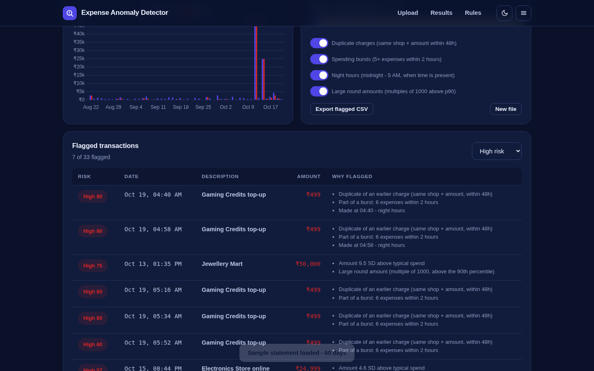

# Expense Anomaly Detector

Upload a bank statement or expense export and get a review list of transactions that do not fit the pattern - every flag shows its **exact reasons** and a transparent risk score. Rule-based statistics, no black box, nothing leaves your browser.

**Live:** https://akash991833.github.io/expense-anomaly-detector/



## Detection rules (all tunable live)

- **Statistical outliers**: z-score against your own spending distribution, with relaxed / standard / strict sensitivity.
- **Duplicate charges**: same shop + same amount within 48 hours.
- **Spending bursts**: 5+ expenses within a 2-hour window.
- **Night hours**: transactions between midnight and 5 AM (when your export includes times).
- **Large round amounts**: multiples of 1000 above the 90th percentile.

## Features

- CSV / TSV / Excel intake with smart column mapping (signed or all-expense direction).
- KPI tiles, daily-spend timeline chart with flagged amounts overlaid in red.
- Filter by risk band, export the flagged list as CSV.
- Built-in sample statement (60 days, planted anomalies) to try it instantly.
- PWA: installable, offline, dark + light themes, mobile + desktop.

## Honest limits

This is a statistics-and-rules screening tool, not a fraud verdict. False positives are normal - a legitimate big purchase gets flagged; that is the point of a review list.

## Tech

Vanilla JS + Chart.js + SheetJS (vendored). No build step, no tracking.

## Run locally

```bash
python3 -m http.server 8080
```

## Tests

`tests/run.mjs` (Puppeteer): verifies planted anomalies are caught (night hours, duplicates, bursts, outliers), sensitivity changes flag counts, band filter works, no console errors - desktop/mobile x light/dark.

## Python version (scikit-learn + Streamlit)

A pro-grade rebuild with real IsolationForest ML and a rule engine lives in [`python-app/`](python-app/) - see its README for run steps. The browser demo above stays the zero-install option.
